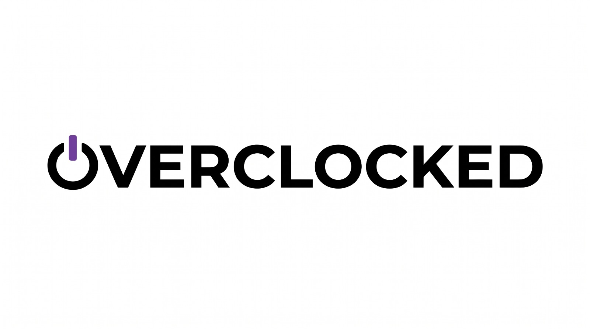

<div align="center">
  
  <br />
  <h3>Simulador Educacional Isométrico 3D de Suporte e Rotina em TI</h3>
</div>

---

## 🖥️ Sobre o Jogo

**OVERCLOCKED** é um jogo educativo e simulador em **3D isométrico** desenvolvido com **React, TypeScript e Three.js** que coloca o jogador no papel de um(a) Analista de Suporte Técnico recém-contratado(a) na **NexusCorp Operações**.

Durante o expediente, você percorre **15 setores corporativos**, conversa com funcionários (com vozes em Português separadas por gênero), diagnostica **64 chamados reais** de **Hardware, Software, Redes e Pegadinhas (Camada 8)** e gerencia sua energia visitando fisicamente a **Cafeteria OverCoffee**.

---

## ✨ Principais Funcionalidades

- **15 Setores Corporativos em 3D Isométrico**: Recepção, Administrativo, Financeiro, RH, Comercial, Marketing, Desenvolvimento, Help Desk, Manutenção, Laboratório QA, Redes, Servidores, Sala de Reuniões, Almoxarifado e Convivência.
- **64 Chamados Técnicos Didáticos**:
  - **Hardware**: Fonte ATX, cabos de força/vídeo/rede, poeira na ventoinha, memória RAM mal encaixada, pendrive no boot e impressora.
  - **Software (OverOS)**: Processos travados em 100% de CPU, disco/lixeira cheia, driver de áudio e atualizações.
  - **Redes**: Wi-Fi, renovação de IP via DHCP, DNS (`8.8.8.8`) e Firewall.
  - **Pegadinha (Erro Humano)**: Monitor desligado no botão, brilho no mínimo e Caps Lock ativado na senha.
- **Espaço Físico da Cafeteria OverCoffee**: Sala completa no mapa 3D com balcão de espresso, mesas bistrô, sofá e colegas para conversar.
- **Sistema de Energia & Exaustão**:
  - Aviso crítico quando a energia atinge **20%**.
  - Caso chegue a **0%**, a tela escurece por **2 segundos** (*"dormiu no serviço"*), descontando pontos da sua conta.
- **Progressão, Guarda-Roupa e Medalhas**: 16 roupas, 21 acessórios 3D e 8 medalhas de carreira.

---

## 🚀 Como Rodar no Seu Computador

1. Instale o [Node.js (versão LTS)](https://nodejs.org/).
2. No terminal, dentro da pasta do projeto, instale as dependências:
   ```bash
   npm install --legacy-peer-deps
   ```
3. Inicie o servidor de desenvolvimento:
   ```bash
   npm run dev
   ```
4. Acesse no navegador:
   ```text
   http://localhost:3000
   ```

---

## 🌐 Como Publicar no GitHub Pages

Este projeto já inclui o fluxo automático `.github/workflows/deploy.yml`:
1. Suba o código para um repositório no seu GitHub (`branch main`).
2. No seu repositório do GitHub, vá em **Settings → Pages**.
3. Em **Build and deployment → Source**, selecione **GitHub Actions**.
4. O GitHub vai compilar e publicar seu jogo automaticamente em `https://SEU_USUARIO.github.io/NOME_DO_REPOSITORIO/`!
